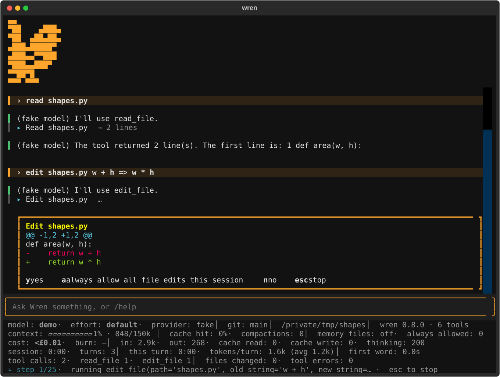

# Wren

<picture>
  <source media="(prefers-color-scheme: dark)" srcset="docs/branding/wren-logo-dark.svg">
  
</picture>

A small, readable coding-agent harness for the terminal, built step by step so every part can be understood.

[](https://github.com/bensullivan2002/wren/actions/workflows/ci.yml)

> **Status: step 10 of the roadmap.** Wren is a full-screen terminal app that chats with Claude or OpenAI's models (with an API key, or, for OpenAI, your ChatGPT plan), explores your project, and changes it: it edits files and runs commands such as your tests, asking your permission first, or not, in auto mode. On macOS its commands run in a sandbox: no network, and writes only inside the project, so they don't need asking about. It saves every conversation so you can resume it, switches models mid-conversation, reads standing instructions from `WREN.md` or `AGENTS.md`, caches what it re-sends, and compacts long conversations to keep them affordable.

## Quickstart

You need Python 3.10 or newer and an API key from Anthropic or OpenAI, or a ChatGPT plan (see "Paying with your ChatGPT plan").

```bash
git clone https://github.com/bensullivan2002/wren.git
cd wren
python -m venv .venv
source .venv/bin/activate          # Windows: .venv\Scripts\activate
pip install -e ".[dev]"

export ANTHROPIC_API_KEY=sk-ant-...
wren
```

If you use [uv](https://docs.astral.sh/uv/): `uv sync --extra dev`, then `uv run wren`.

**No API key?** `wren --provider fake` starts Wren with a pretend model. It's free and offline. It echoes what you type, except for a few commands that make it call real tools, so you can watch the agent loop and the permission prompts work: `ls [pattern]`, `read <path>`, `search <regex>`, `write <path> <text>`, `edit <path> <old> => <new>`, `run <command>`.

## Using it

Run `wren` inside the project you want to work on: its file tools can only see that folder. The Wren bird is pinned at the top left, above the conversation: chatting, scrolling, `/clear` and resuming don't move it. Terminals under 30 rows or 20 columns show `wren` instead, leaving room for the conversation. The logo is decoration only, never part of the conversation sent to the model.

The full-screen app asks permission in place:



Type in the box at the bottom. Replies stream into the conversation as rendered markdown. Each tool call shows as one line; edits show their diff, and commands the end of their output.

Below the box, a footer keeps six rows up to date: the model, effort, provider and who pays (`provider: openai (ChatGPT plan)`), git branch and folder; how full the context is; what you've spent and how fast; how long the session and the current turn have taken; which tools have been called; and what Wren is doing right now. Everything in it counts from when you opened Wren. Cost comes from a price table in each provider, copied from its pricing page; a model that isn't in the table shows `£?`. It's shown in pounds at the day's European Central Bank rate, which the app looks up the first time it opens each day (the one network call Wren makes that isn't to the model) and keeps in `~/.wren/exchange-rate.json`. Until it has a rate, it shows dollars. In a narrow terminal, the least important parts are left out.

| Key | What it does |
| --- | --- |
| Enter | Send your message |
| Ctrl+J | Start a new line in your message |
| Escape | Close the command panel if it's open; otherwise stop Wren while it's working |
| `y` / `a` / `n` | Answer a permission question |
| Ctrl+C | Copy the text you've selected with the mouse |
| Ctrl+P | Textual's command palette (themes, and more) |
| Ctrl+Q | Quit |

Slash commands open in a panel above the prompt: the arrow keys scroll or choose, and Escape closes it and returns you to the chat. Commands that only show you something leave nothing in the conversation.

Escape stops Wren at once in most cases. Anything it had already done stays done, and stays in the conversation, so Wren knows where it left off.

**Plain mode.** `wren --plain` gives the original line-by-line interface, and Wren uses it automatically when its input or output isn't a terminal (`echo "explain main.py" | wren`). There, Ctrl-C stops a turn and Ctrl-D quits.

### Permission

Wren asks before every file edit (unless you turn on auto mode, below) and every shell command that runs outside the sandbox (on macOS, below; elsewhere, every command), and shows you exactly what it will do. For a command, it first says in plain English what the command is for, in Wren's own words, with the command itself underneath: read the description to understand it, and the command to check it.

| Answer | Meaning |
| ------ | ------- |
| `y`    | Yes, this once |
| `n`    | No. Wren is told you declined, and should ask how you'd like to proceed |
| `a`    | Yes, and don't ask again this session for this kind of thing: all file edits, or commands starting with the same word |

`a` is only offered for simple commands: anything with `;`, `&&`, pipes, `$` or redirects is asked about every time. "Always" answers are forgotten when you quit. Reading, listing and searching never ask.

**The sandbox (macOS).** Every command runs in a sandbox the operating system enforces: it can read your files (but not `~/.ssh`, `~/.aws` and other places keys live), write only inside the project and temporary folders, and has no network. It can't write `.git`, `.envrc`, `.vscode`, `.idea`, `.claude` or `.codex`, in any folder of the project (a git worktree inside it has its own), because git, direnv, editors and other agents run things from those later, outside the sandbox. So `git status` and `git diff` work there; `git commit` doesn't. A command in the sandbox runs without a question, in either mode: the operating system enforces what you'd be asked to judge, and the conversation shows what ran. A command that needs more (installing packages, committing, pushing) is run outside the sandbox, and the question says so: "Run a shell command outside the sandbox". On other systems there's no sandbox yet.

**Auto mode.** `/auto` stops the questions for edits to the project's files too. Wren still asks before a command outside the sandbox, and before an edit to `.envrc`, `.vscode`, `.idea`, `.claude` or `.codex`. The footer shows `auto: on` while it lasts; `/auto` again turns it off, and quitting forgets it. Without a sandbox, auto mode still asks about every command.

Two things neither the sandbox nor auto mode protects against: what Wren writes for later (a test or a `Makefile` runs outside the sandbox when *you* run it), and edits to memory files such as `WREN.md`, which steer future conversations. A command in the sandbox can change any ordinary file in the project without a question, in either mode. Read the changes (`git diff`) before you run or commit them.

| Command         | What it does                                          |
| --------------- | ----------------------------------------------------- |
| `/help`         | List the commands                                     |
| `/tools`        | List the tools Wren can use                           |
| `/tools NAME`   | Show exactly what the model is told about one tool    |
| `/history`      | Show the conversation exactly as Wren holds it        |
| `/system`       | Show the system prompt sent with every request        |
| `/usage`        | Tokens used this session, and how full the context is |
| `/compact`      | Replace the conversation with a summary, to save tokens |
| `/provider`     | Choose a different provider (`/provider NAME`)        |
| `/model`        | Choose a different model (`/model NAME` switches directly) |
| `/effort`       | Choose how hard the model works (`/effort LEVEL`)     |
| `/resume`       | Go back to an earlier conversation in this folder     |
| `/permissions`  | Show what you've said Wren may always do this session |
| `/auto`         | Switch auto mode on or off                            |
| `/memory`       | Show which memory files are loaded                    |
| `/remember X`   | Add the note X to the project's memory file           |
| `/clear`        | Start a fresh conversation (the old one stays saved)  |
| `/quit`         | Exit                                                  |

### Saved conversations

Every conversation is saved as it happens, to `~/.wren/sessions/`, grouped by project folder.

| To | Do |
| --- | --- |
| Pick an earlier conversation as you start | `wren --resume` |
| Go straight to one | `wren --resume ID` (the first few characters will do) |
| Switch conversation from inside Wren | `/resume` |
| Start a new one | `/clear` (the old one is kept) |

Resuming brings back the conversation and the model it was using. It does not bring back "always allow" answers, and your files are however they are now, so Wren may need to re-read them. If Wren was closed mid-turn, the unfinished step is marked as such.

The files are plain text, readable only by your user account, and kept until you delete them. They contain whatever Wren read, so treat them as you would the project itself.

### Providers

| Provider | Start with | Key | Starts on |
| --- | --- | --- | --- |
| Claude (the default) | `wren` | `ANTHROPIC_API_KEY` | `claude-opus-5-5`, `xhigh` effort |
| OpenAI | `wren --provider openai` | `OPENAI_API_KEY` | `gpt-6.1-sol`, `xhigh` effort |
| A pretend model, offline | `wren --provider fake` | none | `demo` |

(Those are Wren's own defaults. Yours, if you've set them, replace them: see "Models".)

`export WREN_PROVIDER=openai` makes OpenAI the default, and `/provider` switches in the middle of a conversation: the conversation carries over, the next reply is billed in full once, and the previous model's private reasoning is left behind. A provider whose key isn't set can't be chosen. Everything else works the same on either. The OpenAI provider is tested against the SDK's types but has not yet been run against the live API. A conversation resumed under a different provider carries on, without the earlier model's private reasoning.

### Paying with your ChatGPT plan

OpenAI's models can be paid for from your ChatGPT plan instead of an API key:

```bash
wren login                                  # sign in with ChatGPT in your browser, once
wren --provider openai --auth chatgpt       # or: export WREN_OPENAI_AUTH=chatgpt
```

| Command | What it does |
| --- | --- |
| `wren login` | Opens your browser to sign in with ChatGPT and allow Wren to use your plan. Again later: signs back in to the same account |
| `wren auth-status` | Shows the saved sign-in: the account, whether plan usage is allowed, how long the token lasts. Never shows a token |
| `wren logout` | Ends the session at OpenAI and deletes the tokens (keeps the registration, so `wren login` is quicker next time) |

What to know:

- **It's your plan's allowance, not a new one.** Requests count against the same limits as ChatGPT and any other app you've allowed. See and limit them at [chatgpt.com/settings/usage](https://chatgpt.com/settings/usage). Plan usage isn't priced per token, so the footer's cost shows it as unknown.
- **Wren never switches who pays.** `--auth` is read once, at startup. If the plan can't be used (not signed in, the permission declined, a usage limit, a temporary fault), the request stops with an error that says why; it isn't retried with your API key, another provider or bought credits. To pay another way, start Wren with `--auth api-key`. Whatever your plan settings say about credits is up to them: Wren doesn't choose.
- **Where it's kept.** `~/.wren/auth/`, readable only by you, and out of reach of commands Wren runs in its sandbox. Codex's sign-in files aren't touched.
- **Limits of this first version** ([issue #19](https://github.com/bensullivan2002/wren/issues/19), a spike): one ChatGPT account; tried against a real account for streamed replies and a tool call, and still being tried for the rest; a temporary failure isn't retried by itself; `--max-tokens` doesn't apply (this route refuses the setting); the browser must be on the same computer. Details in [journal 10](docs/journal/10-chatgpt-sign-in.md).

### Models

`/model` lists the models your provider offers and switches to the one you pick (to change provider, use `/provider`); `/model NAME` switches directly. The conversation carries over. The first reply from a new model costs full price for the whole conversation, because the cache is kept per model. `/usage` shows the model the API reports as having written the last reply, so you can confirm a switch took effect. `--model` or `WREN_MODEL` sets the model Wren starts with.

**Making a choice your default.** In the `/model` and `/effort` pickers, **Enter** chooses and keeps the choice as your default for every future session (in `~/.wren/settings.json`, one entry per provider); **Space** chooses for this session only, and leaves your saved default alone. Choosing a model with Enter saves it with that model's own default effort, so pick an effort with Enter afterwards if you want a specific one. An effort chosen with Enter is saved with your default model: if you're on a model you chose with Space, it applies to the session and isn't saved. `/model NAME` and `/effort LEVEL` typed out, and the plain `--plain` mode, never save anything. Starting Wren is not choosing a model, so it uses your saved model *and* effort as they are. Without a saved default, Wren starts on the models in the table above.

`/effort` chooses how hard the model works on each reply (how much it thinks, how thorough it is): higher is slower and costs more. The levels offered are the ones the current model accepts (for OpenAI, every level the API knows, since it can't be asked per model); `/effort LEVEL` sets one directly, `/effort default` hands the choice back to the model, and `--effort` or `WREN_EFFORT` sets it at launch. Changing model puts effort back to that model's default. Some providers offer effort as part of the model choice and not as a separate setting; there, `/effort` tells you to look in `/model`.

`/usage` separates the current model's documented default effort, the effort Wren sent with the last request, the effort returned by the API (OpenAI's `response.reasoning.effort`, when present), and the last reply's thinking-token count. Missing response effort is shown as "not reported", never filled in from local settings. Response effort is metadata from the API, not a measurement of how hard the model actually worked. This last-call metadata isn't saved across restarts; send a message after restarting or resuming to check it.

### Memory: standing instructions

Wren reads instructions from files at the start of every conversation and puts them in its system prompt:

| File | For |
| --- | --- |
| `~/.wren/WREN.md` | Your preferences, in every project |
| `WREN.md` in the project | How to build and test, conventions, what to leave alone |
| `AGENTS.md` in the project | The same, under the [open-standard](https://agents.md) name; used where a folder has no `WREN.md` |

Project files are looked for in the working directory and each folder above it, up to the top of the git repository. Where files disagree, the more specific one wins, and what you say in the conversation wins over all of them. Keep them short: they're sent with every request.

`/remember run the tests with make check` adds a line to the project's file. Changes take effect in the next conversation (`/clear`, or restart). Wren tells you at startup which files it loaded; `/memory` lists them.

**These files steer the model, and in a repository you've cloned, you didn't write them.** They can't approve anything: every edit and command still asks you first.

### Long conversations

Every request re-sends the whole conversation, so a long session costs more with each step. Wren does two things about it:

- **Caching.** The part of each request that was sent before is billed at about a tenth of the price. Nothing to configure. `/usage` shows how much was read from the cache.
- **Compaction.** When the conversation nears the model's context window, Wren asks the model to summarise it and carries on from the summary. It compacts at the window less room for one reply (`--max-tokens`) and a 10% margin: for a 1,050,000-token window and 32,000-token replies, at 913,000. The footer's context bar shows how close you are (`context: ▰▱▱▱▱▱▱▱▱▱ 2% · 18k/913k`), and `/usage` shows the window and where the figure came from: the Anthropic API reports it; for OpenAI it's from OpenAI's model pages. If a model's window isn't known, Wren doesn't compact by itself. Run `/compact` to do it at a moment you choose, such as after finishing a task. A summary loses detail: Wren may need to re-read files afterwards.

### Tools

| Tool         | What it does                                                    |
| ------------ | --------------------------------------------------------------- |
| `list_files` | List files and folders, optionally by glob (`**/*.py`)          |
| `read_file`  | Read a file with line numbers, 500 lines at a time              |
| `search`     | Find lines matching a regular expression across the project     |
| `edit_file`  | Replace an exact piece of text in a file (asks first)           |
| `write_file` | Create a file, or replace one completely (asks first)           |
| `shell`      | Run a command: tests, git, builds (asks first)                  |

The file tools are confined to the working directory, skip folders like `.git`, `node_modules` and `.venv` when listing and searching, and never write inside `.git`. **`shell` is confined only by the sandbox** (macOS): a command can read most of what you can, and one run outside the sandbox, or on a system without one, can do anything you can. The permission prompt is the safeguard for those.

## Configuration

Each setting can come from a flag, an environment variable, or the default, in that order of priority. For the model and effort the default has two layers: what you saved with Enter in the pickers, then Wren's own (Opus 5.5 and GPT 6.1 Sol, at `xhigh`). An effort you didn't ask for goes with the model it was saved for: `--model` or `WREN_MODEL` naming a different model starts at that model's own effort.

| Flag           | Environment variable | Default             |
| -------------- | -------------------- | ------------------- |
| `--provider`   | `WREN_PROVIDER`      | `anthropic` (or `openai`, `fake`) |
| `--model`      | `WREN_MODEL`         | your saved default, else the provider's |
| `--max-tokens` | `WREN_MAX_TOKENS`    | `32000`             |
| `--max-steps`  | `WREN_MAX_STEPS`     | no limit            |
| `--context-budget` | `WREN_CONTEXT_BUDGET` | none: just short of the model's window |
| `--effort`     | `WREN_EFFORT`        | your saved default, else `xhigh` (for the default model); another model: its own |
| `--auth`       | `WREN_OPENAI_AUTH`   | `api-key` (or `chatgpt`, after `wren login`); OpenAI only, and never saved |
| `--resume [ID]` |                     |                     |
| `--plain`      |                      | off                 |

`--max-tokens` limits one reply, including the model's private thinking. `--max-steps` limits how many times Wren calls the model in one turn before it stops and checks in with you; by default there's no limit (0 means the same), and Escape stops a turn at any point. `--context-budget` caps how large the conversation may grow before Wren compacts it, for example to keep long conversations cheaper. It can only bring compaction earlier than the window would; 0 means never compact by itself (`/compact` still works).

## How it works

The docs are written to teach, not just to reference:

- **[Architecture](docs/ARCHITECTURE.md)**: how Wren is put together right now, and how a turn flows through it.
- **[Decisions](docs/DECISIONS.md)**: every significant choice we made, and why.
- **[Logo kit](docs/branding/)**: light/dark wordmarks, small pixel icons, and a terminal-friendly bird.
- **[Build journal](docs/journal/)**: one entry per step, explaining the ideas behind what we built.
  1. [Foundations: a chat loop you own](docs/journal/01-foundations.md)
  2. [Tools: the agent loop](docs/journal/02-tools.md)
  3. [Acting safely: edits, commands and permission](docs/journal/03-acting-safely.md)
  4. [A full-screen interface](docs/journal/04-terminal-ui.md)
  5. [Context: what a long conversation costs](docs/journal/05-context.md)
  6. [Memory: instructions that outlast a conversation](docs/journal/06-memory.md)
  7. [Sessions, and switching models](docs/journal/07-sessions.md)
  8. [A second provider: OpenAI](docs/journal/08-openai.md)
  9. [Auto mode, and a sandbox to make it safe](docs/journal/09-auto-mode.md)
  10. [Paying with a ChatGPT plan: signing in with OAuth](docs/journal/10-chatgpt-sign-in.md)

## Roadmap

- [x] **1. Foundations**: conversation state, a swappable model provider, streaming, the terminal loop
- [x] **2. Tools, read-only**: the real agent loop; Wren can list, read and search files
- [x] **3. Acting safely**: typed tool inputs (Pydantic), editing files and running commands, behind permission prompts
- [x] **4. A better terminal UI**: a full-screen app with rendered markdown, diffs, in-place permission questions, and Escape to stop
- [x] **5. Context management**: prompt caching, a context meter, and compaction at a token budget
- [x] **6. Project memory**: standing instructions from `WREN.md` or `AGENTS.md`, per project and personal, with `/remember`
- [x] **7. Sessions**: conversations saved as they happen, a picker to resume them, and model switching
- [x] **8. A second provider**: OpenAI, through the same interface as Claude
- [x] **9. Auto mode**: a sandbox for commands (macOS), and `/auto` to stop asking about what it contains
- [x] **10. Paying with a ChatGPT plan**: `wren login` (OAuth with PKCE), and `--auth chatgpt` for OpenAI's models, never falling back to an API key (a spike: [issue #19](https://github.com/bensullivan2002/wren/issues/19))
- [ ] **11. Extensions**: subagents, MCP servers, hooks

## Development

```bash
pip install -e ".[dev]"       # or: uv sync --extra dev
pre-commit install            # once: lint and format the files in each commit
pytest                        # the tests
pre-commit run --all-files    # the lint and format checks, on every file
git config blame.ignoreRevsFile .git-blame-ignore-revs   # once: blame looks past the big reformat
```

The tests use a fake model, so they need no API key and no network. The app's tests run it headless and press its keys.

**CI** runs on every pull request and every push to `main`:

- the pre-commit checks: [ruff](https://docs.astral.sh/ruff/) lint and format, plus whitespace and file checks;
- `pip-audit` on the locked dependencies;
- the tests on Linux and macOS, with Python 3.10 and 3.14. The sandbox's tests only run on macOS.

Dependabot proposes dependency updates weekly. The choices behind all of this are D108 to D115 in [Decisions](docs/DECISIONS.md).

```
src/wren/
  cli.py            entry point: flags -> config -> provider + tools -> agent -> a front end
  config.py         settings and where they come from
  prompts.py        the system prompt, and the prompt used to compact a conversation
  memory.py         finds and loads WREN.md / AGENTS.md; /remember
  sessions.py       saves conversations as JSON Lines; lists and loads them
  settings.py       the model and effort you chose to keep (~/.wren/settings.json)
  agent.py          owns the conversation; runs the agent loop; compacts it
  messages.py       provider-neutral message types, and the history rules
  tui.py            the full-screen front end (Textual)
  footer.py         the rows at the bottom of the full-screen app
  stats.py          tokens, cost, times and tool calls since Wren opened, for the footer
  exchange.py       the day's dollar-to-pound rate, looked up once a day
  repl.py           the plain front end (--plain, pipes)
  commands.py       slash commands, shared by both front ends
  providers/
    base.py         the Provider interface
    anthropic.py    Claude, via the Anthropic Messages API
    openai.py       OpenAI's models, via the Responses API
    openai_plan.py  the same, paid for by a ChatGPT plan: its request rules and errors
    fake.py         a pretend model for tests and the offline demo
  auth/
    chatgpt.py      Sign in with ChatGPT: OAuth with PKCE, the ID token, refresh, sign-out
    callback.py     the one-request web server the browser returns to
    store.py        where the sign-in is kept (~/.wren/auth/, owner-only)
    cli.py          wren login, wren logout, wren auth-status
  tools/
    base.py         the Tool interface; Pydantic inputs -> schema and checked arguments
    registry.py     looks up, checks, gets permission for, runs and caps every tool call
    permissions.py  what needs asking, what's "always" allowed this session, and auto mode
    sandbox.py      the macOS sandbox commands run in (sandbox-exec and its profile)
    files.py        path fencing, folder walking, glob matching, safe text read/write, diffs
    list_files.py   ┐
    read_file.py    ├ read-only tools
    search.py       ┘
    edit_file.py    ┐
    write_file.py   ├ tools that change things (and ask first)
    shell.py        ┘
tests/              unit and end-to-end tests
docs/               architecture, decisions, build journal
.github/
  workflows/ci.yml  lint, audit and tests, on every pull request
  dependabot.yml    weekly dependency updates
.pre-commit-config.yaml   the checks run on each commit, and by CI
```
