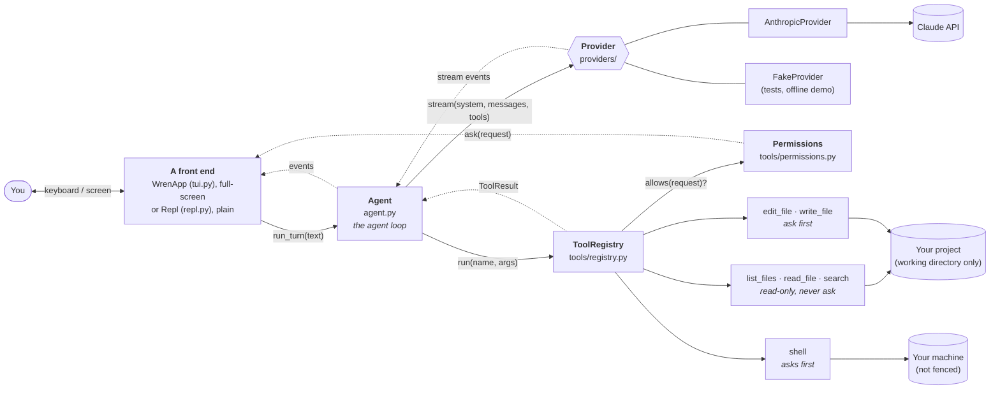

# Architecture

*Describes Wren as of **step 4**. This page is rewritten as Wren grows, so it always matches the code. For how it got this way, see the [build journal](journal/).*

## The big picture

A language model is, at heart, a function: text in, text out. It has no memory, no hands and no idea where it's running. The **harness** is everything around it that turns that function into something useful: it holds the conversation, talks to the API, shows the output, runs tools on the model's behalf, and decides what the model is allowed to do.

Wren is that harness. `cli.py` builds the parts and wires them together:



Solid arrows are calls; dotted arrows are what comes back, or a callback. One front end runs at a time: the full-screen app in a terminal, the plain REPL with `--plain` or when input or output is a pipe.

## The parts

| Part | File | Its job | What it knows about |
| --- | --- | --- | --- |
| **Entry point** | `cli.py` | Parse flags, load config, build everything, pick and start a front end | Everything (the only file that does) |
| **Config** | `config.py` | Decide each setting: flag, then env var, then default | Nothing else |
| **System prompt** | `prompts.py` | Who the model is, how to work, plus live facts: folder, OS, date | Nothing else |
| **Agent** | `agent.py` | Own the conversation; run the agent loop; keep history valid and truthful | A `Provider`, a `ToolRegistry`, the message types |
| **Messages** | `messages.py` | Provider-neutral types; the history rules (`history_problems`) | Nothing else |
| **Provider** | `providers/` | Translate to a vendor's API and back; stream the reply | The vendor SDK, the message types |
| **Tool registry** | `tools/registry.py` | Look up tools, check arguments, get permission, run, turn failures into error results, cap output | The `Tool` interface, `Permissions` |
| **Tool base** | `tools/base.py` | What a tool is; turn an `Input` model into a schema and into checked arguments | Pydantic |
| **Permissions** | `tools/permissions.py` | Remember what's "always" allowed this session; otherwise ask, through a callback | Nothing else |
| **Tools** | `tools/*.py` | Do one job each; describe themselves to the model, and their effects to the user | The working directory (via `ToolContext`) |
| **App** | `tui.py` | The full-screen front end (Textual): run each turn on a worker thread, draw events as widgets, ask permission questions, stop on Escape | The `Agent`, the event types, Textual |
| **REPL** | `repl.py` | The plain front end: read a line, print events, ask permission questions with `input()` | The `Agent`, the event types |
| **Commands** | `commands.py` | Slash commands, returning text for either front end to show | The `Agent` |

The rule behind this table: **each part knows as little as possible about the others.** The agent never prints and never touches files. Tools don't know there's a model, and never call `input()`. Nothing outside `providers/anthropic.py` knows what Anthropic's JSON looks like. Nothing outside `tui.py` knows about Textual. That's what lets us swap the model, have two interfaces, add tools, or test any part alone.

## Anatomy of a tool

```python
class EditFile(Tool):
    name = "edit_file"                       # ┐ what the model sees,
    description = "Change an existing…"      # ┤ together with the schema
    class Input(ToolInput): ...              # ┘ generated from this model

    def permission(self, args, ctx): ...     # what the user is asked (None = don't ask)
    def run(self, args, ctx): ...            # the work
```

One Pydantic `Input` model per tool is the single source for the JSON Schema sent to the model, the validation of what comes back, and the typed `args` object `run()` receives. `ToolInput` makes every input strict (no type conversions) and closed (unknown arguments are errors).

## The life of a turn

What happens when you type *"rename helper to assist in util.py"* and press Enter:

1. **The front end** calls `agent.run_turn(text)` and shows each event it yields. (In the app, that call is on a worker thread: see "The full-screen app" below.)
2. **`Agent.run_turn`** appends your message.
3. **The loop begins.** `_call_model` sends the system prompt, the **entire** history and the **tool specs** to the provider.
4. **The provider** translates to Anthropic's format and streams the reply. Text arrives as `TextDelta` events, which the REPL prints immediately. One `Completed` event ends the reply, carrying the assembled message, the stop reason and the token counts.
5. **The agent appends the reply** to the history. Does it contain tool requests?
   - **No:** the turn is over. The agent yields `TurnFinished`, and the REPL prints the usage line.
   - **Yes:** carry on to step 6.
6. **For each tool request,** the agent yields `ToolStarted`, calls `registry.run(name, args)`, and yields `ToolFinished`. The registry:
   1. finds the tool, or returns an error result listing the real ones;
   2. parses the arguments into the tool's `Input`, filling in defaults (`Tool.parse`);
   3. asks the tool what it's about to change (`Tool.permission`). Read-only tools say nothing. `edit_file` works out the edit and returns a diff; an edit that can't work fails here;
   4. if there's a request, asks `Permissions.allows`. That returns at once if the scope is already "always" allowed, and otherwise calls the front end's `ask_permission`, which shows the request and waits for y / n / a. A no becomes an error result telling the model not to retry;
   5. calls `tool.run(args, ctx)`, turning any exception into an error result;
   6. caps the output's size.
7. **All the results go into one user message**, appended to the history, and the loop returns to step 3.
8. **If the loop reaches `max_steps`,** the agent appends a short assistant note saying it stopped, and yields `TurnFinished(hit_step_limit=True)`.

**If the turn is cut short** between steps 2 and 8 (Escape or Ctrl-C, a network error, a bad API key), nothing is deleted. `Agent._close_unfinished_turn` ties off the loose ends: every unanswered tool request gets a result (the real one if the tool finished, otherwise a note that it was cut short or never ran), and a closing assistant note records where and why the turn stopped, after any text that had already streamed.

## Events and callbacks: the front-end contract

The agent's output is a stream of events. Each front end decides how they look:

| Event | From | Meaning | In the app | In the REPL |
| --- | --- | --- | --- | --- |
| `TextDelta` | provider | a fragment of the model's text | appended to a `Markdown` widget | printed as it arrives |
| `Completed` | provider | one model call finished | the reply widget is closed | newline; warning if cut off |
| `ToolStarted` | agent | about to run a tool | a `ToolCallView` line, ending `…` | `▸ edit_file(path='util.py', …)` |
| `ToolFinished` | agent | the tool's result | summary, plus the diff or the end of a command's output | `→ util.py +1 −1`, or `✗ declined` |
| `TurnFinished` | agent | the whole turn is over | status line updated | `↳ 3,210 in · 250 out · 2 model calls` |

Three things flow the other way, from a front end into the core:

| Hook | Set on | In the app | In the REPL |
| --- | --- | --- | --- |
| Permission question | `Permissions.ask` | `WrenApp.ask_permission`: shows a `PermissionPrompt`, waits for a key | `Repl.ask_permission`: prints, then `input()` |
| Stop the turn | closing the `run_turn` generator | Escape sets a flag; the worker's loop breaks | Ctrl-C |
| Stop a slow tool | `ToolContext.should_stop` | the same flag; the shell polls it | not used (Ctrl-C interrupts directly) |

A permission question needs an answer *before* the tool runs, so it's a callback, not an event. It's called synchronously, between `ToolStarted` and `ToolFinished`.

## The full-screen app

Textual runs an event loop on the main thread: it redraws, reads keys, and calls our handlers, each of which must return quickly. The agent blocks for seconds at a time. So:

| Thread | Runs | May touch widgets? |
| --- | --- | --- |
| app (the event loop) | `compose`, key and message handlers, `show_event`, `show_question`, `turn_ended` | yes |
| worker (one per turn) | `run_turn`: the agent's loop, and everything it calls, including tools and `ask_permission` | **no**: it asks the app thread, with `call_from_thread`, and waits |

Three objects cross between them: each event (worker to app, in order, one at a time); a `Future` holding the answer to a permission question (app to worker); and a `threading.Event`, the stop flag (app to worker).

The screen is a column: a header line, the scrolling transcript, a status line, and the prompt box. The transcript holds one widget per thing that happened: your message, a reply, a tool call, a question, a note. All text from outside (model, files, commands) is passed as Rich `Text` or with `markup=False`, so it's never read as Textual markup.

## Permission scopes

| Tool | Asks? | "Always" scope | Covers |
| --- | --- | --- | --- |
| `list_files`, `read_file`, `search` | never | | |
| `edit_file`, `write_file` | yes | `edit` | all file edits (working directory only, never `.git`) |
| `shell`, simple command | yes | `shell:<first word>` | commands starting with that word |
| `shell`, with any shell syntax (`;`, `&&`, pipes, `$`, redirects, brackets, line breaks) | every time | none | |

Scopes live in `Permissions.always`, in memory, until Wren exits. `/permissions` lists them.

## Rules that always hold

These are *invariants*: things the code guarantees, so the rest of the code can rely on them.

1. **Between turns, the history is valid.** `history_problems(agent.messages)` is empty: it starts with the user and ends with the assistant, every `tool_use` is answered by id in the next message, and no message is empty.
2. **The history is truthful.** Anything a tool did stays in the history, even if the turn was interrupted or failed. Nothing that happened is ever removed (except by `/clear`).
3. **Every provider stream ends with exactly one `Completed`.** Zero or more `TextDelta` come first.
4. **Tools never crash the loop.** Every failure becomes an error result the model can read. Only Ctrl-C escapes.
5. **Nothing changes without permission.** A tool whose `permission()` returns a request runs only if `Permissions.allows` said yes. With nobody to ask, the answer is no.
6. **Nobody is asked about a call that can't run.** Arguments are validated, and edits worked out, before the question.
7. **File tools stay inside the working directory.** Every path is resolved (following `..` and symlinks) *before* it's checked. Writing tools also refuse anything inside `.git`. *(The shell is the exception: it is not fenced. See the journal.)*
8. **No tool result exceeds 50,000 characters.**
9. **Vendor formats never leak.** Only a provider module sees its vendor's request and response shapes.
10. **The agent and the tools never do I/O with the user.** The agent yields events; permission questions go through a callback. Front ends decide what to show.
11. **Front ends are interchangeable.** The agent, tools and providers contain nothing specific to the app or to the REPL.
12. **In the app, only the app's thread touches widgets.** The worker thread reaches the screen through `call_from_thread`.
13. **Text from outside is never interpreted as markup.**

## Where the next steps plug in

| Coming in | Plugs in at |
| --- | --- |
| Step 5: context management | Inside `Agent`, just before each call to the provider; a context meter in the status line |
| Step 7: sessions | Saving and loading `agent.messages`; the app would redraw the transcript from them |
| Later: saved permission rules | Loaded into `Permissions.always` at startup |
| Later: sandboxing | Around `tools/shell.py`'s `_run` |
