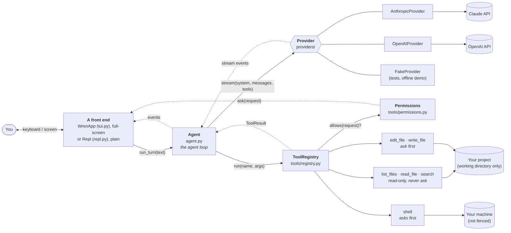

# Architecture

*Describes Wren as of **step 8**. This page is rewritten as Wren grows, so it always matches the code. For how it got this way, see the [build journal](journal/).*

## The big picture

A language model is, at heart, a function: text in, text out. It has no memory, no hands and no idea where it's running. The **harness** is everything around it that turns that function into something useful: it holds the conversation, talks to the API, shows the output, runs tools on the model's behalf, and decides what the model is allowed to do.

Wren is that harness. `cli.py` builds the parts and wires them together:



Solid arrows are calls; dotted arrows are what comes back, or a callback. One front end runs at a time: the full-screen app in a terminal, the plain REPL with `--plain` or when input or output is a pipe.

## The parts

| Part | File | Its job | What it knows about |
| --- | --- | --- | --- |
| **Entry point** | `cli.py` | Parse flags, load config, build everything, pick and start a front end | Everything (the only file that does) |
| **Config** | `config.py` | Decide each setting: flag, then env var, then default | Nothing else |
| **Prompts** | `prompts.py` | The system prompt (who the model is, how to work, the memory files, plus live facts: folder, OS, date) and the compaction prompt | Nothing else |
| **Memory** | `memory.py` | Find and read the memory files (`WREN.md`, `AGENTS.md`); render them for the prompt; append `/remember` notes | The file helpers |
| **Agent** | `agent.py` | Own the conversation; run the agent loop; keep history valid and truthful; track its size and compact it | A `Provider`, a `ToolRegistry`, the message types |
| **Messages** | `messages.py` | Provider-neutral types; the history rules (`history_problems`) | Nothing else |
| **Provider** | `providers/` | Translate to a vendor's API and back; stream the reply; ask for caching; report token use; list its models | The vendor SDK, the message types |
| **Tool registry** | `tools/registry.py` | Look up tools, check arguments, get permission, run, turn failures into error results, cap output | The `Tool` interface, `Permissions` |
| **Tool base** | `tools/base.py` | What a tool is; turn an `Input` model into a schema and into checked arguments | Pydantic |
| **Permissions** | `tools/permissions.py` | Remember what's "always" allowed this session; otherwise ask, through a callback | Nothing else |
| **Tools** | `tools/*.py` | Do one job each; describe themselves to the model, and their effects to the user | The working directory (via `ToolContext`) |
| **App** | `tui.py` | The full-screen front end (Textual): run each turn on a worker thread, draw events as widgets, ask permission questions, stop on Escape | The `Agent`, the event types, Textual |
| **REPL** | `repl.py` | The plain front end: read a line, print events, ask permission questions with `input()` | The `Agent`, the event types |
| **Sessions** | `sessions.py` | Write the conversation to a JSON Lines file as it happens; list and load saved sessions | The message types |
| **Commands** | `commands.py` | Slash commands, returning text for either front end to show; resuming a session, switching model | The `Agent`, `Memory`, `SessionStore` |

The rule behind this table: **each part knows as little as possible about the others.** The agent never prints and never touches files. Tools don't know there's a model, and never call `input()`. Nothing outside `providers/anthropic.py` knows what Anthropic's JSON looks like, and nothing outside `providers/openai.py` knows OpenAI's. Nothing outside `tui.py` knows about Textual. That's what lets us swap the model, have two interfaces, add tools, or test any part alone.

## Anatomy of a tool

```python
class EditFile(Tool):
    name = "edit_file"                       # ┐ what the model sees,
    description = "Change an existing…"      # ┤ together with the schema
    class Input(ToolInput): ...              # ┘ generated from this model

    def permission(self, args, ctx): ...     # what the user is asked (None = don't ask)
    def run(self, args, ctx): ...            # the work
```

One Pydantic `Input` model per tool is the single source for the JSON Schema sent to the model, the validation of what comes back, and the typed `args` object `run()` receives. `ToolInput` makes every input strict (no type conversions) and closed (unknown arguments are errors).

## The life of a turn

What happens when you type *"rename helper to assist in util.py"* and press Enter:

1. **The front end** calls `agent.run_turn(text)` and shows each event it yields. (In the app, that call is on a worker thread: see "The full-screen app" below.)
2. **`Agent.run_turn`** first checks the conversation's size. If it's over the context budget, it compacts (see "Context" below). Then it appends your message.
3. **The loop begins.** `_call_model` sends the system prompt, the **entire** history and the **tool specs** to the provider.
4. **The provider** translates to Anthropic's format, marks the request for caching, and streams the reply. Text arrives as `TextDelta` events, which the REPL prints immediately. One `Completed` event ends the reply, carrying the assembled message, the stop reason and the token counts.
5. **The agent records the conversation's new size** from the reply's token counts, and **appends the reply** to the history, including any reasoning blocks, untouched. Does it contain tool requests?
   - **No:** the turn is over. The agent yields `TurnFinished`, and the REPL prints the usage line.
   - **Yes:** carry on to step 6.
6. **For each tool request,** the agent yields `ToolStarted`, calls `registry.run(name, args)`, and yields `ToolFinished`. The registry:
   1. finds the tool, or returns an error result listing the real ones;
   2. parses the arguments into the tool's `Input`, filling in defaults (`Tool.parse`);
   3. asks the tool what it's about to change (`Tool.permission`). Read-only tools say nothing. `edit_file` works out the edit and returns a diff; an edit that can't work fails here;
   4. if there's a request, asks `Permissions.allows`. That returns at once if the scope is already "always" allowed, and otherwise calls the front end's `ask_permission`, which shows the request and waits for y / n / a. A no becomes an error result telling the model not to retry;
   5. calls `tool.run(args, ctx)`, turning any exception into an error result;
   6. caps the output's size.
7. **All the results go into one user message**, appended to the history, and the loop returns to step 3.
8. **If the loop reaches `max_steps`,** the agent appends a short assistant note saying it stopped, and yields `TurnFinished(hit_step_limit=True)`.

**If the turn is cut short** between steps 2 and 8 (Escape or Ctrl-C, a network error, a bad API key), nothing is deleted. `Agent._close_unfinished_turn` ties off the loose ends: every unanswered tool request gets a result (the real one if the tool finished, otherwise a note that it was cut short or never ran), and a closing assistant note records where and why the turn stopped, after any text that had already streamed.

## Memory files

At the start of a conversation, `Memory.load` reads, in this order:

1. `~/.wren/WREN.md` (personal);
2. for each folder from the top of the git repository down to the working directory: `WREN.md`, or `AGENTS.md` if that folder has no `WREN.md`. Outside a repository, only the working directory.

Empty files are skipped; each is capped at 20,000 characters. `Memory.render` wraps them in a `<memory>` section, each file labelled with its path and scope, under a header saying how to weigh them and that they can't grant permission. `build_system_prompt` places that section between the fixed text and the environment.

`cli.py` gives the agent a *function* that builds the system prompt. The agent calls it when it's created and on `reset()` (`/clear`), and at no other time, so the prompt is fixed for the length of a conversation. Both front ends announce the loaded files at startup. `/remember` appends to the project file nearest the working directory (creating `WREN.md` if there is none); the change is seen from the next conversation.

Memory lives in the system prompt, which compaction doesn't touch, so it survives compaction unchanged.

## Providers

A provider turns Wren's neutral history into one vendor's request, and that vendor's reply back into neutral types. The `Provider` protocol is: `name`, `model`, `effort`, `stream(...)`, `models()`, `efforts()`, `default_effort()`.

| | `anthropic` | `openai` | `fake` |
| --- | --- | --- | --- |
| API | Messages | Responses, with `store: False` | none |
| History sent as | messages of content blocks | a flat list of items | n/a |
| Reasoning kept as | `thinking` blocks | `reasoning` items with encrypted content | none |
| Caching | requested with `cache_control` | automatic | none |
| Tool arguments | a JSON object | a JSON string, parsed on arrival | a dict |
| Effort levels | asked of the API, per model | every level offered; the API can't be asked | fixed |
| Default model | `claude-sonnet-5-5` | `gpt-5.6-terra` | `demo` |
| Key | `ANTHROPIC_API_KEY` | `OPENAI_API_KEY` | none |

Each provider stores its own reasoning as a `ReasoningBlock` tagged with its name, and leaves out any block tagged with another's. `Usage` means the same thing from every provider: `input_tokens` is the uncached part, and `sent_tokens` is everything sent.

`Completed` keeps effort sources separate: `effort_sent` is Wren's request record; `effort_reported` is optional response metadata. OpenAI reads the latter from `response.reasoning.effort`, never from the request. `Agent.last_call` carries it to `/usage` in both front ends; absent or null effort is shown as "not reported". Last-call metadata isn't persisted in session files.

## Sessions

**Writing.** The agent has an optional `journal` (the `Journal` protocol: `append`, `replace`, `model_changed`, `spent`, `reset`). Every message joins the history through `Agent._add`, which also tells the journal. `SessionStore` is the journal `cli.py` installs: it appends one JSON line per event to `~/.wren/sessions/<project>/<id>.jsonl`, creating the file (mode `0o600`) at the first message.

| Line type | Written when | On replay |
| --- | --- | --- |
| `meta` | the file is created | records version, folder, time, provider and model |
| `message` | a message is added | appended to the history |
| `replaced` | a compaction | the history so far is swapped for the messages it carries |
| `model` | `/model` or `/effort` | the session's model and effort are updated |
| `spent` | a model call finishes | its token counts are added to the conversation's totals; its `context_tokens` becomes the conversation's size |

`/clear` makes the next message start a new file; the old one is kept.

**Reading.** `sessions.load` replays a file from the top. A broken last line (a crash mid-write) is ignored; a broken line elsewhere, or a newer format version, is an error. Unknown line types are skipped.

**Resuming** (`commands.resume_session`): point the store at the session's file, then `Agent.restore(messages)`. `restore` ties off a turn that was cut short (the same code as an interruption, with wording that says the tool's outcome is unknown), checks `history_problems`, and refuses the session, keeping the current conversation, if it still isn't valid. The session's model and effort are restored when the provider matches, and so are the conversation's token totals and its measured size. Permissions and the system prompt are not restored: the prompt is rebuilt from today's memory files.

**Entry points.** `wren --resume` starts the front end on the session list; `wren --resume ID` resumes before it starts; `/resume` and `/resume ID` do the same from inside. In the app, the list is a `Picker` and the transcript is redrawn from the history.

## Switching provider, model and effort

`Agent.set_provider` replaces the agent's provider object. `commands.switch_provider` builds the new one with `make_provider`, after checking its API key is set, using the model this conversation last used with that provider, or else the provider's default. The history is untouched; each provider leaves out the other's `ReasoningBlock`s. Resuming a session returns to its provider when that provider's key is available.


A provider has a `model` and an `effort` (None for the model's default), both read on each request. `Agent.set_model` and `Agent.set_effort` set them and tell the journal; switching model puts effort back to None.

`/effort` lists `provider.efforts()`: the levels the current model accepts as a separate setting. A provider whose models have none (unsupported, or folded into the model's name) returns an empty list, and the front end says to look in `/model`. `/effort LEVEL` and `--effort` set one directly; an unset effort is left out of the request.

`Agent.set_model` sets `provider.model`, which the provider reads on each request, and tells the journal. `/model` lists `provider.models()` (asked of the API; in the app, on the worker thread) in a `Picker`; `/model NAME` switches directly. The conversation carries over unchanged. The prompt cache is per model, so the next request is uncached, and another model's reasoning blocks are ignored by the new one.

## Context: size, caching and compaction

**The request is always built the same way:** tools, then the system prompt, then the messages in order, with new material only at the end. Prompt caching depends on that. The provider adds `cache_control` to every request, and the API reads the unchanged beginning back at about a tenth of the price.

**Size is measured, not counted.** After each model call, `agent.context_tokens` is set from the reply's own usage: everything that was sent (fresh, cache-written and cache-read) plus what was written back. `Usage` carries those parts separately; `sent_tokens` is their sum.

**Compaction** (`Agent.compact`) makes one model call, the conversation plus `COMPACT_PROMPT`, and then replaces the whole history with two messages: a note that the earlier part was removed, and the model's summary. It runs:

- automatically at the start of a turn, when `context_tokens >= context_budget` (150,000 by default; 0 disables it);
- when the user runs `/compact`.

It changes nothing unless it has a good summary in hand: a provider error, a reply that calls a tool or is empty, a summary cut off by `max_tokens`, or the user stopping it all leave the history as it was. A failed automatic compaction doesn't stop the turn.

**Reasoning blocks.** A model's private reasoning arrives as blocks in its reply. Wren stores each as a `ReasoningBlock`: the provider's own data, kept in position and sent back unchanged, and opened by nothing but that provider. Compaction keeps only the summary's text, so the new history contains none.

## Events and callbacks: the front-end contract

The agent's output is a stream of events. Each front end decides how they look:

| Event | From | Meaning | In the app | In the REPL |
| --- | --- | --- | --- | --- |
| `TextDelta` | provider | a fragment of the model's text | appended to a `Markdown` widget | printed as it arrives |
| `Completed` | provider | one model call finished | the reply widget is closed | newline; warning if cut off |
| `ToolStarted` | agent | about to run a tool | a `ToolCallView` line, ending `…` | `▸ edit_file(path='util.py', …)` |
| `ToolFinished` | agent | the tool's result | summary, plus the diff or the end of a command's output | `→ util.py +1 −1`, or `✗ declined` |
| `TurnFinished` | agent | the whole turn is over | status line updated | `↳ 3,210 in (2,900 cached) · 250 out · 2 model calls` |
| `CompactionStarted` | agent | about to summarise the conversation | a note | a note |
| `Compacted` | agent | done (or failed, with `error` set) | a note with before and after sizes | the same |

Three things flow the other way, from a front end into the core:

| Hook | Set on | In the app | In the REPL |
| --- | --- | --- | --- |
| Permission question | `Permissions.ask` | `WrenApp.ask_permission`: shows a `PermissionPrompt`, waits for a key | `Repl.ask_permission`: prints, then `input()` |
| A choice from a list (provider, model, effort, session) | a `CommandResult` flag from `commands.py` | a `Picker` in the command panel | a printed list, and a command to type |
| Reference output (`/usage`, `/history`, …) | `CommandResult.panel` | the command panel, closed with Escape | printed |
| Stop the turn | closing the `run_turn` generator | Escape sets a flag; the worker's loop breaks | Ctrl-C |
| Stop a slow tool | `ToolContext.should_stop` | the same flag; the shell polls it | not used (Ctrl-C interrupts directly) |

A permission question needs an answer *before* the tool runs, so it's a callback, not an event. It's called synchronously, between `ToolStarted` and `ToolFinished`.

## The full-screen app

Textual runs an event loop on the main thread: it redraws, reads keys, and calls our handlers, each of which must return quickly. The agent blocks for seconds at a time. So:

| Thread | Runs | May touch widgets? |
| --- | --- | --- |
| app (the event loop) | `compose`, key and message handlers, `show_event`, `show_question`, `turn_ended` | yes |
| worker (one per turn) | `run_turn`: the agent's loop, and everything it calls, including tools and `ask_permission` | **no**: it asks the app thread, with `call_from_thread`, and waits |

Three objects cross between them: each event (worker to app, in order, one at a time); a `Future` holding the answer to a permission question (app to worker); and a `threading.Event`, the stop flag (app to worker).

The screen is a column: a top-docked logo, a header line, then a body containing the scrolling transcript, command panel, status line, and prompt box. The body fills the remaining screen space. Inside it, the transcript and panel share a flexible chat area above the status and prompt. The panel's percentage height is relative to that chat area, so the pinned logo and a multiline prompt both have their space reserved first. The transcript holds one widget per thing that happened: your message, a reply, a tool call, a question, a note. All text from outside (model, files, commands) is passed as Rich `Text` or with `markup=False`, so it's never read as Textual markup.

The theme-coloured bird is a top-docked `Static` outside the transcript, pinned at the top left in new and resumed conversations. Chatting, scrolling, `/clear` and history redraws do not move or recreate it. It is never a model message or session record. The mark is loaded with `importlib.resources` from `wren/wren-terminal.txt`, so installed apps do not depend on the repo's docs or working directory. The branding generator keeps this packaged copy identical to the design asset. Below 20 columns or 20 rows, the welcome falls back to `wren`, adapting as the terminal is resized. Plain mode is unchanged.

## Permission scopes

| Tool | Asks? | "Always" scope | Covers |
| --- | --- | --- | --- |
| `list_files`, `read_file`, `search` | never | | |
| `edit_file`, `write_file` | yes | `edit` | all file edits (working directory only, never `.git`) |
| `shell`, simple command | yes | `shell:<first word>` | commands starting with that word |
| `shell`, with any shell syntax (`;`, `&&`, pipes, `$`, redirects, brackets, line breaks) | every time | none | |

Scopes live in `Permissions.always`, in memory, until Wren exits. `/permissions` lists them.

## Rules that always hold

These are *invariants*: things the code guarantees, so the rest of the code can rely on them.

1. **Between turns, the history is valid.** `history_problems(agent.messages)` is empty: it starts with the user and ends with the assistant, every `tool_use` is answered by id in the next message, and no message is empty.
2. **The history is truthful, and append-only between compactions.** Anything a tool did stays in the history, even if the turn was interrupted or failed. Nothing is removed or rewritten except by compaction, which replaces all of it with a summary, and `/clear`.
3. **Every provider stream ends with exactly one `Completed`.** Zero or more `TextDelta` come first.
4. **Tools never crash the loop.** Every failure becomes an error result the model can read. Only Ctrl-C escapes.
5. **Nothing changes without permission.** A tool whose `permission()` returns a request runs only if `Permissions.allows` said yes. With nobody to ask, the answer is no.
6. **Nobody is asked about a call that can't run.** Arguments are validated, and edits worked out, before the question.
7. **File tools stay inside the working directory.** Every path is resolved (following `..` and symlinks) *before* it's checked. Writing tools also refuse anything inside `.git`. *(The shell is the exception: it is not fenced. See the journal.)*
8. **No tool result exceeds 50,000 characters.**
9. **Vendor formats never leak.** Only a provider module sees its vendor's request and response shapes. Adding a provider changes no file outside `providers/`, `config.py` and `cli.py`.
10. **The agent and the tools never do I/O with the user.** The agent yields events; permission questions go through a callback. Front ends decide what to show.
11. **Front ends are interchangeable.** The agent, tools and providers contain nothing specific to the app or to the REPL.
12. **In the app, only the app's thread touches widgets.** The worker thread reaches the screen through `call_from_thread`.
13. **Text from outside is never interpreted as markup.**
    Reference output from slash commands goes in the command panel, not the transcript: the transcript holds the conversation and the events in it.
14. **Compaction is all or nothing.** It either replaces the whole history with a summary or leaves it exactly as it was.
15. **Reasoning blocks are returned as they came:** same data, same position. Only the provider that produced one looks inside it.
16. **Requests are built identically every time,** with new content only at the end, so the cached prefix stays valid.
17. **The system prompt is fixed for the length of a conversation.** Memory files are read when a conversation starts, and not again until the next.
18. **Memory files can't grant permission.** They are text in the prompt; the permission check in the registry doesn't read them.
19. **Memory is looked for only in the home directory's `.wren/`, and from the working directory up to the top of its git repository.**
20. **Every message enters the history through `Agent._add`,** so the journal sees each one, in order, as it happens.
21. **A session file is only ever appended to.** Nothing already written is changed, including by compaction.
22. **A restored history is valid or it isn't used.** `restore` ties off loose ends, then `history_problems` must be empty.
23. **Session files are outside the project and private to the user** (`0o700` folders, `0o600` files).
24. **However the app closes, it releases its worker thread.**

## Where the next steps plug in

| Coming in | Plugs in at |
| --- | --- |
| Step 9: MCP | More tools in the `ToolRegistry`, provided by other programs; each needs a `permission()` story |
| Step 9: subagents | A second `Agent` with its own history, run as a tool of the first |
| Step 9: hooks | Around `ToolRegistry.run` and at turn boundaries in `Agent` |
| Later: saved permission rules | Loaded into `Permissions.always` at startup |
| Later: sandboxing | Around `tools/shell.py`'s `_run` |
