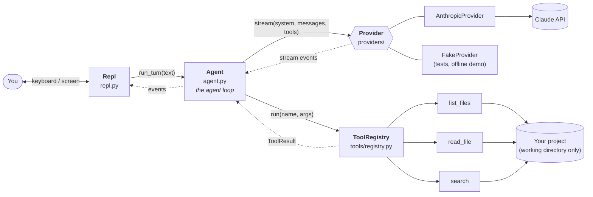

# Architecture

*Describes Wren as of **step 2**. This page is rewritten as Wren grows, so it always matches the code. For how it got this way, see the [build journal](journal/).*

## The big picture

A language model is, at heart, a function: text in, text out. It has no memory, no hands and no idea where it's running. The **harness** is everything around it that turns that function into something useful: it holds the conversation, talks to the API, shows the output, and runs tools on the model's behalf.

Wren is that harness. `cli.py` builds the parts and wires them together:

Solid arrows are calls; dotted arrows are what comes back.

## The parts

| Part | File | Its job | What it knows about |
| --- | --- | --- | --- |
| **Entry point** | `cli.py` | Parse flags, load config, build everything, start the REPL | Everything (the only file that does) |
| **Config** | `config.py` | Decide each setting: flag, then env var, then default | Nothing else |
| **System prompt** | `prompts.py` | Who the model is, how to work, plus live facts: folder, OS, date | Nothing else |
| **Agent** | `agent.py` | Own the conversation; run the agent loop; keep history valid | A `Provider`, a `ToolRegistry`, the message types |
| **Messages** | `messages.py` | Provider-neutral types; the history rules (`history_problems`) | Nothing else |
| **Provider** | `providers/` | Translate to a vendor's API and back; stream the reply | The vendor SDK, the message types |
| **Tool registry** | `tools/registry.py` | Look up tools, validate arguments, run them, turn failures into error results, cap output | The `Tool` interface |
| **Tools** | `tools/*.py` | Do one job each; describe themselves to the model | The working directory (via `ToolContext`) |
| **REPL** | `repl.py` | Read your input, show events, run slash commands | The `Agent`, the event and message types |

The rule behind this table: **each part knows as little as possible about the others.** The agent never prints and never touches files. Tools don't know there's a model. Nothing outside `providers/anthropic.py` knows what Anthropic's JSON looks like. That's what lets us swap the model, swap the interface, add tools, or test any part alone.

## The life of a turn

What happens when you type *"what does main.py do?"* and press Enter:

1. **`Repl.turn`** calls `agent.run_turn(text)` and shows each event it yields.
2. **`Agent.run_turn`** notes a checkpoint (the history's current length) and appends your message.
3. **The loop begins.** `_call_model` sends the system prompt, the **entire** history and the **tool specs** to the provider.
4. **The provider** translates to Anthropic's format and streams the reply. Text arrives as `TextDelta` events, which the REPL prints immediately. One `Completed` event ends the reply, carrying the assembled message, the stop reason and the token counts.
5. **The agent appends the reply** to the history. Does it contain tool requests?
   - **No:** the turn is over. The agent yields `TurnFinished`, and the REPL prints the usage line.
   - **Yes:** carry on to step 6.
6. **For each tool request,** the agent yields `ToolStarted`, calls `registry.run(name, args)`, and yields `ToolFinished`. The registry:
   1. finds the tool, or returns an error result listing the real ones;
   2. validates the arguments against its schema, filling in defaults;
   3. calls `tool.run(args, ctx)`, turning any exception into an error result;
   4. caps the output's size.
7. **All the results go into one user message**, appended to the history, and the loop returns to step 3.
8. **If the loop reaches `max_steps`,** the agent appends a short assistant note saying it stopped, and yields `TurnFinished(hit_step_limit=True)`.

If anything escapes between steps 2 and 8 (Ctrl-C, a network error, a bad API key), the agent deletes everything after the checkpoint, including any tool calls and results from this turn.

## Events

The agent's output is a stream of events. The REPL decides how each looks:

| Event | From | Meaning | Shown as |
| --- | --- | --- | --- |
| `TextDelta` | provider | a fragment of the model's text | printed as it arrives |
| `Completed` | provider | one model call finished | (newline; warning if cut off) |
| `ToolStarted` | agent | about to run a tool | `▸ read_file(path='main.py')` |
| `ToolFinished` | agent | the tool's result | `→ 42 lines`, or `✗ No such file…` in red |
| `TurnFinished` | agent | the whole turn is over | `↳ 3,210 in · 250 out · 2 model calls` |

## Rules that always hold

These are *invariants*: things the code guarantees, so the rest of the code can rely on them.

1. **Between turns, the history is valid.** `history_problems(agent.messages)` is empty: it starts with the user and ends with the assistant, every `tool_use` is answered by id in the next message, and no message is empty. Interrupted or failed turns leave no trace.
2. **Every provider stream ends with exactly one `Completed`.** Zero or more `TextDelta` come first.
3. **Tools never crash the loop.** Every failure becomes an error result the model can read. Only Ctrl-C escapes.
4. **Tools stay inside the working directory.** Every path is resolved (following `..` and symlinks) *before* it's checked.
5. **No tool result exceeds 50,000 characters.**
6. **Vendor formats never leak.** Only a provider module sees its vendor's request and response shapes.
7. **The agent never does I/O with the user.** It yields events; front ends decide what to show.

## Where the next steps plug in

| Coming in | Plugs in at |
| --- | --- |
| Step 3: typed tool inputs | Each tool's schema becomes a Pydantic model; `tools/validation.py` is deleted |
| Step 3: edit and shell tools | New files in `tools/` |
| Step 3: permissions | `ToolRegistry.run`, between validation and `tool.run` |
| Step 3: rollback rethink | `Agent.run_turn`: once tools have side effects, discarding history no longer undoes them |
| Step 4: richer UI | A replacement for `repl.py`; the agent doesn't change |
| Step 5: context management | Inside `Agent`, just before each call to the provider |
