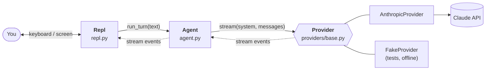

# Architecture

*Describes Wren as of **step 1**. This page is rewritten as Wren grows, so it always matches the code. For how it got this way, see the [build journal](journal/).*

## The big picture

A language model is, at heart, a function: text in, text out. It has no memory, no hands and no idea where it's running. The **harness** is everything around it that turns that function into something useful: it holds the conversation, talks to the API, shows the output and, from step 2, runs tools on the model's behalf.

Wren is that harness. Right now it has four parts, each in its own file, wired together by `cli.py`:

Solid arrows are calls; dotted arrows are the events that flow back while the model is writing.

## The parts

| Part | File | Its job | What it knows about |
| --- | --- | --- | --- |
| **Entry point** | `cli.py` | Parse flags, load config, build everything, start the REPL | Everything (it's the only file that does) |
| **Config** | `config.py` | Decide each setting: flag, then env var, then default | Nothing else |
| **System prompt** | `prompts.py` | Who the model is, plus live facts: folder, OS, date | Nothing else |
| **Agent** | `agent.py` | Own the conversation; run a turn; keep history valid | A `Provider`, and the message types |
| **Messages** | `messages.py` | Provider-neutral types: messages, blocks, stream events | Nothing else |
| **Provider** | `providers/` | Translate to a vendor's API and back; stream the reply | The vendor SDK, and the message types |
| **REPL** | `repl.py` | Read your input, show events, run slash commands | The `Agent`, and the message types |

The rule behind this table: **each part knows as little as possible about the others.** The agent never prints. The REPL never talks to the API. Nothing outside `providers/anthropic.py` knows what Anthropic's JSON looks like. That's what lets us swap the model, swap the interface, or test any part alone.

## The life of a turn

What happens when you type `hello` and press Enter:

1. **`Repl.run`** reads the line with `input()` and, since it isn't a `/command`, calls `Repl.turn("hello")`.
2. **`Repl.turn`** calls `agent.run_turn("hello")` and loops over the events it yields.
3. **`Agent.run_turn`** notes a checkpoint (the current length of the history), appends `Message.user("hello")`, and calls `provider.stream(...)` with the system prompt and the **entire** history.
4. **`AnthropicProvider.stream`** translates the history into Anthropic's JSON format and opens a streaming request.
5. As text arrives, the provider yields `TextDelta` events. They pass up through the agent untouched, and the REPL prints each one the moment it arrives.
6. When the reply ends, the provider yields one `Completed` event carrying the assembled message, why the model stopped, and the token counts.
7. The agent appends the assistant message to the history and adds the usage to its running total.
8. The REPL prints a newline and the dim usage line, then shows the prompt again.

If anything goes wrong between steps 3 and 7 (Ctrl-C, a network error, a bad API key), the agent deletes everything after the checkpoint, so the history is exactly as it was before you pressed Enter.

## Rules that always hold

These are *invariants*: things the code guarantees, so the rest of the code can rely on them.

1. **Between turns, the history is complete.** It's empty, or a sequence of user, assistant, user, assistant… ending with an assistant reply. A failed or interrupted turn leaves no trace.
2. **Every provider stream ends with exactly one `Completed`.** Zero or more `TextDelta` come first.
3. **Vendor formats never leak.** Only a provider module sees its vendor's request and response shapes.
4. **The agent never does I/O with the user.** It yields events; front ends decide what to show.

## Where the next steps plug in

| Coming in | Plugs in at |
| --- | --- |
| Step 2: tools | `Agent.run_turn` becomes a loop; `Provider.stream` gains a `tools` parameter; a new `tools/` package |
| Step 3: permissions | Between the agent deciding to run a tool and the tool running |
| Step 4: richer UI | A replacement for `repl.py`; the agent doesn't change |
| Step 5: context management | Inside `Agent`, just before each call to the provider |
