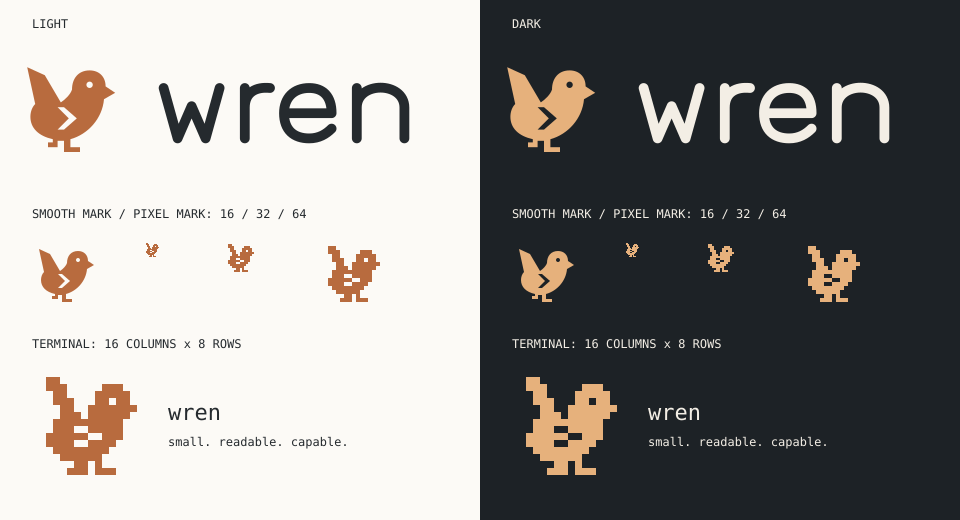

# Wren logo kit

A small bird for a small, readable tool. The raised tail makes it a wren;
the `>` cut out of the wing connects it to the terminal without putting
the bird inside a generic terminal-window badge.

The terminal bird appears in the TUI when you start a new conversation
and after `/clear`. It scrolls with the transcript, uses the theme's accent,
and never enters model history or saved sessions. Plain/piped output is unchanged.

## Preview



The wordmark uses custom rounded vector lettering, not a font. All SVGs
are self-contained: no scripts, external images, downloaded fonts or network
requests. The eye and wing are transparent cutouts, not background-coloured paint.

## Which asset to use

- `wren-logo-light.svg`: full wordmark on a light background.
- `wren-logo-dark.svg`: full wordmark on a dark background.
- `wren-mark.svg`: smooth, copper bird for icons at **48 px and above**.
- `wren-pixel.svg`: hand-drawn **16 × 16** bird for small icons. Display at
  integer multiples (16, 32, 48, 64…) with nearest-neighbour scaling.
- `wren-pixel-16.png`, `wren-pixel-32.png`: transparent, unsmoothed small icons.
- `wren-pixel-128.png`: the same pixel mark enlarged for uploads that need PNG.
- `wren-terminal.txt`: the pixel mark packed into **16 columns × 8 rows**
  using `▀`, `▄`, and `█`. No colour codes; it inherits the terminal foreground.
- `wren-ascii.txt`: a plain-ASCII fallback, up to **32 columns × 14 rows**.
  Doubling each pixel horizontally compensates for tall terminal cells;
  the empty top and bottom border rows are omitted.

The pixel mark is deliberately redrawn, **not a reduced smooth SVG**. Its
one-pixel eye, stepped chevron and upright tail stay intact at native size.
The PNGs, pixel SVG, block text and ASCII all come from exactly the same grid.

### GitHub / Markdown

The project's README uses a `<picture>` so GitHub selects the right wordmark:

```html
<picture>
  <source media="(prefers-color-scheme: dark)" srcset="docs/branding/wren-logo-dark.svg">
  
</picture>
```

Paths above are relative to the repository root. Adjust them for nested docs.
Keep descriptive alt text and a text heading: the logo should not be the
only way a screen reader learns the project's name.

### Terminal

The actual block-text asset, shown without colour:

```text
  ▄▄
  ▀██    ▄███▄
   ▀██  ▄██▄██▄
   ▄███▄█████▀
  ▄███▄▄▀▀███
  ▀███▄▄███▀
    ▀▀██▀█
     ▀▀▀ ▀▀▀
```

To preview it from the repository root:

```bash
cat docs/branding/wren-terminal.txt
```

The TUI renders the block text with its theme's accent and normal terminal
line spacing. Spaces stay transparent. Below **20 columns or 20 rows**, it
shows `wren` instead; resizing restores the bird when there is room. Existing
conversations resume without a new banner. Plain mode and piped output do
not print the logo. The contact sheet remains a design mockup, not a screenshot.

For other integrations, use the ASCII version if block glyphs are unavailable.

## Palette and spacing

- Copper `#B86B3E`: the light-background bird and pixel exports.
- Amber `#E6B17C`: the dark-background wordmark's bird.
- Ink `#252A2E`: light-background lettering.
- Paper `#F3EEE5`: dark-background lettering.

Use a single foreground colour when the medium calls for it. Recognition
depends on the silhouette, not the palette. Keep the built-in transparent
padding, preserve proportions, and leave at least one eye-width of clear
space around the mark. For the wordmark, prefer a width of **240 px or more**;
below that, use the bird on its own.

## Source and regeneration

`generate.py` contains the editable geometric paths, custom letter paths,
palette, and 16-row pixel master. It uses Python's standard library only.
The SVGs and PNGs are committed so docs and consumers don't need to build them.
It also writes and checks `src/wren/wren-terminal.txt`, the packaged copy
loaded with `importlib.resources` by the TUI. Installed apps need neither
the docs folder nor a special working directory to display the logo.

```bash
python3 docs/branding/generate.py
python3 docs/branding/generate.py --check
pytest tests/test_branding.py
```

The tests check reproducibility, valid self-contained SVGs, PNG dimensions
and transparency, and agreement between the grid, PNGs and terminal assets.
They cannot decide whether the design looks good: review `preview.svg` and
the actual 16 px / terminal marks before adopting it.

### Design choices, open to review

- A wren silhouette rather than a `W` monogram: connects to the name even
  without the wordmark; the upright tail is the identifying feature.
- A wing chevron rather than a separate cursor: one visual idea, legible in
  one colour, with no tiny extra decoration to lose at small sizes.
- Separate smooth and pixel drawings: more deliberate than automatic
  downsampling, while retaining the same pose and details.
- The TUI welcome is decoration in the scrollback, not a permanent header
  or a message to the model. It reappears after `/clear`; plain mode stays
  unchanged. This follows up the original assets-only logo kit.
