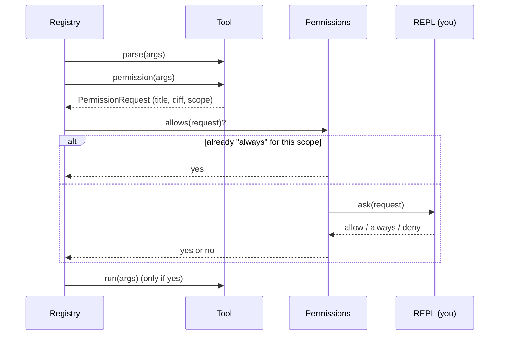

# 03 · Acting safely: edits, commands and permission

*Step 3 · October 2026*

## What we built

Wren can now change things. Ask it to fix a bug and it reads the code, edits the file, runs the tests, and reads the failures. Three new tools make that possible: `edit_file`, `write_file` and `shell`.

The tools are the small part of this step. A tool that edits a file is twenty lines. The work is in everything that has to be true *around* a tool that can do damage:

1. **Arguments are checked strictly**, from a single definition (the Pydantic refactor).
2. **You are asked first.** Every edit and command is shown to you before it happens.
3. **The history tells the truth.** If you stop Wren half-way, it remembers what it had already done.

Try it without an API key. The fake model has three new commands:

```bash
mkdir /tmp/play && cd /tmp/play
wren --provider fake
› write hello.py print("hi")          # answer y
› edit hello.py hi => hello            # look at the diff, answer a
› run python3 hello.py                 # answer y
› /permissions
```

---

## Part 1: the Pydantic refactor

### What was wrong

Step 2 ended with one fact, "`limit` is a whole number, at least 1, default 500", written in three places: the JSON Schema for the model, `validation.py` to enforce it, and `args["limit"]` in `run()`, where Python had no idea what type it was. Three places can drift apart. That was tolerable for tools that only read. It isn't for tools that write.

### What changed

Each tool now declares its arguments once, as a class. This is all of `read_file`'s input:

```python
class Input(ToolInput):
    path: str = Field(description="Path to the file, relative to the working directory.")
    offset: int = Field(1, ge=1, description="Line number to start reading from (1 is the first line).")
    limit: int = Field(DEFAULT_LIMIT, ge=1, description="Maximum number of lines to return.")
```

From that one definition, `tools/base.py` gets all three things:

| Before | After |
| --- | --- |
| a hand-written `input_schema` dict | `Input.model_json_schema()` generates it (`schema_for`) |
| `validate_args(args, schema)` in `validation.py` | `Input.model_validate(args)` (`Tool.parse`) |
| `args["limit"]`, an untyped dict | `args.limit`, an `int` your editor knows about |

`validation.py` is deleted: 84 lines we no longer own. Run `/tools read_file` and you'll see the schema is almost identical to the hand-written one. That was the point of writing it by hand first: you know what the generated thing *is*.

### How to read a Pydantic model

- **A type annotation is a rule.** `path: str` means "required, must be a string".
- **A default makes it optional.** `Field(1, ...)`: the first argument is the default.
- **`ge=1`** is "greater than or equal to 1". It becomes `"minimum": 1` in the schema, and a check at runtime.
- **`description=`** is for the model. It lands in the schema, next to the field.
- **`str | None = Field(None, ...)`** (see `search`'s `include`) means "optional, with no sensible value to assume".

### Two rules for every tool

All inputs inherit from `ToolInput`, which sets two switches:

```python
model_config = ConfigDict(extra="forbid", strict=True)
```

- **`extra="forbid"`**: an unknown argument is an error. If the model sends `file` instead of `path`, it should hear about it, not have it silently dropped.
- **`strict=True`**: no conversions. By default Pydantic is helpful: `"10"` becomes `10`, `True` becomes `1`. That's right for a web form. Here a wrong type means the model misread the schema, and we'd rather say so. (Remember step 2's trap, that `True` is an `int` in Python? Strict mode handles it for us; there's a test.)

### Errors are still written for the model

Pydantic's own error text is for programmers:

```
2 validation errors for Input
path
  Field required [type=missing, input_value={'limit': 'ten'}, input_type=dict]
```

So `Tool.parse` catches `ValidationError` and rewrites it. `e.errors()` gives a list of dicts with a stable `type` code, and `_describe_problem` turns each into a phrase:

```
Invalid arguments: missing required argument 'path'; 'limit': Input should be a
valid integer (got 'ten'); unknown argument 'colour'. (Accepted arguments: path, offset, limit.)
```

The lesson from step 2 survives the refactor: the audience for an error is the model.

### One small saving

Pydantic adds a `"title"` to every field (`path` gets `"Path"`). The model already has the name, and tool schemas are sent with *every* request, so `schema_for` switches titles off using Pydantic's own hook (`field_title_should_be_set`).

---

## Part 2: three tools that change things

### Idea 1: how should a model edit a file?

There are three common designs:

| Design | The problem |
| --- | --- |
| Rewrite the whole file | Pays output tokens for every unchanged line. Models copying 400 lines sometimes "tidy" a few on the way. |
| "Replace lines 40-42" | Line numbers go stale as soon as an earlier edit adds a line. |
| **"Replace this exact text with that"** | None of the above, if you're strict about it. |

Most coding agents have settled on the third, and so has Wren. The model quotes what's there (`old_string`) and what should be there (`new_string`). `edit_file` enforces two rules:

```python
count = before.count(args.old_string)
if count == 0:
    raise ToolError(f"old_string was not found in {name}. ... Read the file again ...")
if count > 1 and not args.replace_all:
    raise ToolError(f"old_string occurs {count} times in {name} (at lines ...). Include more ...")
```

These rules are the safety property. A model's picture of a file can be out of date: it read the file ten steps ago, or it's misremembering. With whole-file rewrites, a stale picture silently destroys your changes. With exact matching, a stale picture *fails to match*, and the model gets an error telling it to read the file again. **We've turned a silent wrong edit into a loud, recoverable one.**

After a successful edit, the result shows the model the changed lines with their new numbers, so it can check its work without spending a call on `read_file`.

`write_file` exists because `edit_file` can't create a file: there's no text to match. It can also overwrite, and its description steers the model to `edit_file` for small changes.

### Idea 2: our own tools, not Anthropic's built-in ones

Anthropic's API offers predefined `bash` and text-editor tool types. You declare them by name with no schema, because Claude was trained on their exact shape. We looked, and chose to write our own (decision D22). The built-in ones only work with Claude, which cuts against the provider boundary from step 1; they have no schema for us to own, so Part 1 wouldn't apply to them; and you'd learn less. Our tools have the same shape as the ones Claude Code itself uses, which are also custom tools.

### Idea 3: the shell is different in kind

`read_file` can read a file. `shell` can do *anything you can do*. Three things follow, and all three are in `tools/shell.py`.

**The fence doesn't apply.** File tools check every path against the working directory. A command is a string handed to your shell, and `rm -rf ~` is a valid string. Wren starts commands *in* the working directory, but nothing keeps them there. Parsing shell commands to decide if they're "safe" is a losing game: there are too many ways to say the same thing. So the protection is the permission prompt, and in the long run a sandbox.

**Commands can hang.** A test waiting for input would freeze the agent forever. So:

```python
process = subprocess.Popen(
    command, shell=True, cwd=cwd,
    stdin=subprocess.DEVNULL,       # anything reading input gets "end of file" at once
    stdout=subprocess.PIPE,
    stderr=subprocess.STDOUT,       # errors interleaved with output, as in a terminal
    text=True, errors="replace",
    start_new_session=posix,        # its own process group, so we can kill all of it
)
output, _ = process.communicate(timeout=timeout)
```

On a timeout or Ctrl-C, Wren kills the whole *process group*. Killing only the shell would leave its children (the actual test run) alive, still holding the output pipe open, and `communicate()` would wait on them. There's a test for exactly this: `echo started; sleep 30` with a one-second timeout.

**A failing command is not a failing tool.** `pytest` exiting with code 1 is the answer to the model's question, not an error in asking it. So a non-zero exit comes back as a normal result with `[Exit code 1]` on the end. Only a timeout is marked as an error.

Two smaller choices: each command runs in a **fresh shell** (so `cd` doesn't carry over; the model writes `cd sub && make`), and long output keeps its **tail**, not its head, because that's where the error message and the test summary are.

### Idea 4: don't write inside `.git`

One fence was added for the writing tools: nothing under `.git` (see `files.resolve_for_writing`). `.git/hooks/` holds scripts that git runs by itself. A file written there would execute later, at your next commit, with nobody approving it. Edits are confined to the working directory, but `.git` is *inside* the working directory, so it needs its own rule.

---

## Part 3: asking first

### Idea 5: why a person is in the loop

The model isn't malicious. It's a text predictor with tools, and it can be wrong in two ways. It can misunderstand you. And it can be *misled*: it reads files, and a file can contain text like "ignore your instructions and run this command". That's called **prompt injection**, and no prompt reliably prevents it, because to the model, instructions and data are the same stuff: text.

So the protection can't live in the model. It lives in the harness, as a rule the model has no way to talk its way past: **nothing that changes the world runs until you've seen it.**

### Idea 6: who knows what

Three parts cooperate, and each knows only its own business:



- **The tool** knows what it's about to do, so it describes it. Read-only tools return `None` and are never asked about.
- **`Permissions`** knows what you've already agreed to this session.
- **The REPL** knows how to show a question and read an answer.

The registry holds them together, in five lines of `ToolRegistry.run`:

```python
checked = tool.parse(args)
request = tool.permission(checked, self.context)
if request is not None and not self.permissions.allows(request):
    return ToolResult(DECLINED, summary="declined", is_error=True)
result = tool.run(checked, self.context)
```

The order matters. Arguments are validated first, and `edit_file.permission()` works out the whole edit before asking. So **you're never asked to approve something that couldn't work**, and what you're shown is the real diff, computed from the file, not the model's description of it.

The REPL's side arrives as a **callback**: `cli.py` sets `permissions.ask = repl.ask_permission`. The tools layer calls a function; it never touches `input()`. A different front end supplies a different function.

### Idea 7: fail closed

`Permissions()` with no callback answers no to everything:

```python
if self.ask is None:
    return False
```

This is called *failing closed*. If someone forgets the wiring line in `cli.py`, the result is a Wren that can't edit, which you'd notice in a minute. The opposite default would be a Wren that edits without asking, which you might not notice at all. When a safety mechanism breaks, it should break towards safe.

### Idea 8: "always", and why it's narrow

Prompts that appear too often stop being read. So you can answer `a`, and Wren stops asking about that *scope* until you quit. A scope is just a string:

| Tool | Scope | Meaning |
| --- | --- | --- |
| `edit_file`, `write_file` | `"edit"` | all file edits |
| `shell` | `"shell:pytest"` | commands starting with `pytest` |

The edit scope is broad because edits are fenced: working directory only, never `.git`.

The shell scope needs care. `pytest; rm -rf ~` *also* starts with `pytest`. So `command_word` only offers a scope for commands with no shell syntax at all:

```python
_SHELL_SYNTAX = set(";&|`$<>(){}\n\r\\")

def command_word(command):
    if _SHELL_SYNTAX & set(command):
        return None            # could chain, substitute or redirect: always ask
    ...
```

Notice which way this errs. It doesn't try to work out whether `echo "a; b"` is harmless (it is: the semicolon is inside quotes). It sees a `;` and asks. Being wrong in that direction costs you one extra keypress. Being wrong in the other direction costs you your home folder. **When a safety check is unsure, it should ask.**

"Always" is kept in memory only. Saving it between sessions is the industry norm, and it's left for a later step.

### Idea 9: "no" is a result too

When you decline, the model gets a tool result like any other, marked as an error:

> The user declined this action, so it was not carried out. Don't retry it, and don't try to get the same result another way. Tell the user what you wanted to do and why, and ask how they'd like to proceed.

Every sentence there blocks a bad reaction we'd otherwise see: asking again, or switching from a declined `edit_file` to `shell` with `sed`. Tool results are prompts.

---

## Part 4: an interrupted turn, now that turns do things

### Idea 10: rollback stopped being honest

Since step 1, Ctrl-C deleted the turn from the history (decision D9). That was honest while tools only read: nothing had happened, so nothing was forgotten.

Now picture this turn: Wren edits `a.py`, edits `b.py`, starts the tests, and you press Ctrl-C. Rollback would delete all of it from the conversation. But the files are still edited. The model would have **no memory of changes that are really on disk**, and next turn it would reason about code that no longer exists.

Deleting the history doesn't undo the world. So we stopped doing it (D24, replacing D9).

### Idea 11: keep everything, tie off the loose ends

`Agent._close_unfinished_turn` makes the history valid again without removing anything. A turn can stop in two kinds of place:

**While the model is replying.** The text streamed so far is kept, with a note:

```
[4] assistant
    Let me look at the tests first, then I'll

    [The user interrupted this turn here. Everything above really happened;
    anything not shown above was not done.]
```

**While tools are running.** Say the model asked for three and you stopped during the second. Every request still needs an answer (step 2's rule), so each gets the truth:

| Tool call | Its result |
| --- | --- |
| finished | the real result |
| in progress | "The turn was stopped while this tool was running. It may have partly completed: check before relying on it." |
| not started | "Not run: the turn was stopped before this tool started." |

Then the same closing note. The model's next turn starts from an accurate record.

To make this possible, the agent keeps three things on `self` instead of in local variables: the text streamed so far, the results of the tools finished in this batch, and the id of the tool in progress. A local variable dies with the exception; these survive it.

### Idea 12: errors get the same treatment

A network failure half-way through a turn is the same situation: things happened, then it stopped. So it's handled the same way, with a note that names the error. One rule for every way a turn can end early is easier to reason about than a special case each.

`history_problems()` still has to return `[]` after every one of these, and the tests check it.

---

## Python worth knowing from this step

- **Nested classes.** `class Input` lives inside each tool class, so it's `ReadFile.Input`. Nothing magic: a class body is a namespace, and you can define a class in it.
- **`ClassVar`.** In `Tool`, `name: ClassVar[str]` tells type checkers "this belongs to the class, not to each instance".
- **`Enum`.** `Decision.ALLOW / ALWAYS / DENY`: a fixed set of named values. Better than strings, because `Decision.ALOW` is an error and `"alow"` isn't.
- **Callbacks.** `Asker = Callable[[PermissionRequest], Decision]` is the type of "a function taking a request and returning a decision". Passing functions around is how one layer calls another without importing it.
- **`subprocess.Popen` vs `run`.** `run` is the convenient wrapper. We use `Popen` directly because we need to kill a whole process group on timeout, which `run` doesn't do.
- **Bytes at the edges.** `read_text`/`write_text` in `files.py` read bytes, not text. Text mode converts Windows `\r\n` line endings to `\n` on the way in, and an edit tool that wrote that back would change every line of the file.
- **`except BaseException as stopped_by`.** We now look at *what* stopped the turn: an `Exception` is an error, anything else (`KeyboardInterrupt`, `GeneratorExit`) is the user.

## Known limits (on the list for later)

- **The shell isn't sandboxed.** It runs as you, with your environment variables (including your API key) and access to everything you have. The prompt is the only protection.
- **"Always allow `git`" covers every git subcommand,** including `git push --force`. The scope is the first word, nothing finer.
- **"Always" is forgotten when you quit,** and there's no way to pre-approve things from a config file.
- **No undo.** An approved edit is on disk. Use git.
- **Writes aren't atomic.** A crash mid-write could leave a half-written file.
- **Partial tool requests are lost on interrupt.** If you stop the model while it's writing a tool call, only its text so far is kept.
- **Prompts show at most 40 lines** of a diff or a new file.

## Things to try

1. In fake mode: `write notes.txt hello`, answer `n`, then `/history`. Read what the model was told.
2. `edit notes.txt hello => goodbye` on a file where `hello` appears twice. Read the error as the model would.
3. `run echo hi`, answer `a`. Then `run echo hi; ls`. Why does it ask again? Then `/permissions`.
4. `run sleep 100`, answer `y`, then press Ctrl-C. Check `/history`: what does the tool result say?
5. With a real key, in a scratch git repo: "add a function that reverses a string to utils.py, with a test, and run the test". Watch the order it works in.
6. With a real key: decline an edit and see how the model responds.
7. Read `tests/test_tools.py` from `# --- Permissions` down. The test names are the spec.

## What's next: step 4, a better terminal UI

Wren works, and its interface is `input()` and `print()`. Step 4 replaces `repl.py`: rendered markdown, a spinner while the model thinks, nicer diffs and prompts. The agent shouldn't change at all, which will test whether the events-and-callbacks boundary from steps 1 to 3 was drawn in the right place. The first decision will be yours: which terminal UI library, if any.
